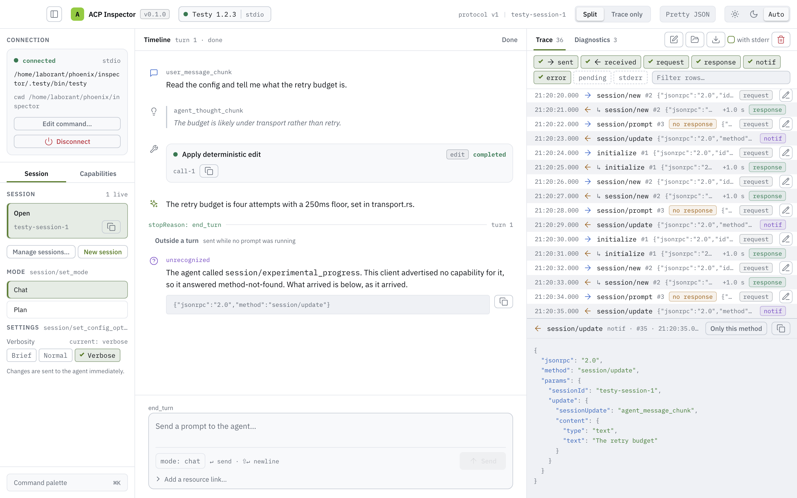

# ACP Inspector

A desktop tool for driving and observing one [Agent Client Protocol](https://agentclientprotocol.com)
agent over stdio. Point it at an agent command and it spawns the agent, speaks ACP v1 to it as a
well-formed client, and shows both conversations at once: the turn as a timeline (messages, tool
calls, permission requests, elicitations) and the wire as a trace of every JSON-RPC frame exactly
as it crossed, with the agent's stderr beside it. It records traffic it does not understand instead
of dropping it, annotates the specification's MUSTs where the captured traffic decides them, and
exports the whole trace as JSONL evidence.

<picture>
  <source media="(prefers-color-scheme: dark)" srcset="design/redesign/populated-1440-dark.png">
  
</picture>

## Quick start

You need:

- **Rust.** Install [rustup](https://rustup.rs); it picks up the pinned toolchain from
  `rust-toolchain.toml` on the first build. The oldest Rust the code builds on is 1.92.
- **[just](https://just.systems)**, which runs every task here.
- **Python 3**, only for the test suite's scripted agents.
- **On Linux**, WebKitGTK and the libraries the desktop shell links. On Ubuntu:
  `sudo apt-get install libwebkit2gtk-4.1-dev libxdo-dev libssl-dev`.
  On macOS there is nothing to install beyond Xcode's Command Line Tools.

Or run `devenv shell` at the repository root, which provides all of it
([devenv](https://devenv.sh)).

Then:

```sh
just run      # cargo run -p acp-inspector
```

The **Connect** dialog asks for an agent. Command is an **executable only**, and each line of
Arguments is one argument, with no shell quoting or expansion. To try it against Claude Code
through its ACP adapter:

| Field             | Value                                   |
| ----------------- | --------------------------------------- |
| Command           | `npx`                                   |
| Arguments         | `@agentclientprotocol/claude-agent-acp` |
| Working directory | the project the agent should work in    |

The adapter uses the same authentication Claude Code does. Launch, and the handshake runs to an
open session; type a prompt and press Enter to watch the turn stream in.

For a deterministic agent that exercises every screen, see [Pointing it at Testy](#pointing-it-at-testy).

## Supported platforms

| Platform | Status |
| --- | --- |
| **macOS 11 or later** | Supported. Released as a disk image per architecture (Apple Silicon and Intel). |
| **Linux** | Build from source. CI builds and tests it on Ubuntu; there is no package. |
| **Windows** | Build from source, untested. CI only checks that it compiles; there is no package. |

**Opening the disk image.** A signed and notarized release opens normally: drag
**ACP Inspector** onto Applications. If macOS says the app "cannot be opened" or "is damaged"
(an unsigned build), open **System Settings → Privacy & Security** and choose **Open Anyway**
for ACP Inspector, or clear the quarantine flag yourself:

```sh
xattr -dr com.apple.quarantine "/Applications/ACP Inspector.app"
```

The image also holds `THIRD_PARTY_LICENSES.html`, the notices for every dependency compiled in
(it is in the app's `Contents/Resources` too).

## Known limitations

- **The inspector does not mediate files or terminals.** It advertises no `fs` or `terminal`
  capability and answers those requests method-not-found, so a real agent reads and writes files
  and runs commands **itself, directly, in its working directory, with your privileges**. Nothing
  is sandboxed or confirmed except what the agent chooses to ask permission for. Point it at a
  directory you are prepared to have changed.
- **Disconnect ends the agent's process group, not every descendant.** A process the agent starts
  that leaves the group (a daemon, a `setsid` child) keeps running after disconnect.
- **Remembered invocations include their environment.** The spawn form's recent commands are saved
  with the environment you entered, API keys included, in plaintext in `recent.json` under the
  platform's state directory (`0600` on Unix). See [where it is kept](#remembered-commands).
- **ACP v1 as of `agent-client-protocol-schema` 1.7.** Messages added to the stable schema later
  are shown raw, as unrecognized traffic, rather than decoded.
- **One agent and one live session at a time**, over stdio only.

## Security

Report vulnerabilities privately; see [SECURITY.md](SECURITY.md).

## Where it is

The frame layer, a shell over it, the typed ACP client, the turn timeline with its inline
permission requests, the capability/auth display, and the JSONL trace export
([spec §14](docs/architecture.md#14-build-order-suggested), all five steps): a connection
factory that spawns an agent over stdio, whole JSON-RPC frames in both directions, a trace that
records every one of them below any typed layer, the agent's stderr in a line-timestamped
diagnostic channel — and above that, a client that drives the spec's cut of v1 (`initialize`,
`authenticate`, `logout`, `session/new`, `session/load`, `session/resume`, `session/list`,
`session/close`, `session/delete`, `session/prompt`, `session/cancel`, `session/set_mode`,
`session/set_config_option`), decodes what comes back **as v1**, and keeps a timeline whose
entries are id-keyed and a turn state the update stream drives. The architecture spec is
[`docs/architecture.md`](docs/architecture.md), where every decision below is argued, in the words
of [`CONTEXT.md`](CONTEXT.md), the project's glossary.

The typed layer decorates the trace; it never replaces it
([§8](docs/architecture.md#8-unknown-traffic-the-raw-first-rule)). Traffic it does not recognize
— an extension method, an update variant v1 has no name for, a client service the inspector
declined by advertising no capability — becomes a first-class unrecognized entry carrying the
frame verbatim, and an agent that calls a declined service is answered method-not-found with the
call recorded as evidence.

The window is a rail and two screens ([ADR 0009](docs/adr/0009-the-window-is-the-drawing.md)):
the connection on the left with the live session's settings and both parties' capabilities behind
two tabs, the turn timeline in the middle, and the console beside it — the trace and the agent's
stderr as two tabs, opening on the trace, with the frame a reader selects read in a pane at
the foot of the list, and expanding onto stderr by itself when an agent is gone without being asked
to go. A **Split | JSON-RPC full** control in the toolbar says whether the two screens share the
width or the wire takes all of it; a window too narrow for three columns shows one region at a time
and puts a **Details | Session | Messages** bar at its foot. Every affordance the window has is
reachable by name from a command palette (`Ctrl`/`⌘` + `K`). Launching an
agent runs the whole handshake, so the composer is ready as soon as there is a session; a prompt
streams into the timeline as the agent sends it, tool calls merge their updates into one card, the
stop button sends `session/cancel`, and the turn's state and its `stopReason` are read from the
stream rather than from the prompt call returning.

What the agent claimed in its `initialize` result is a tab of the rail: its name and version,
every v1 capability it did and did not advertise, and the auth methods it offers. Beside it, the
client identity and every Client Capability sent in the request remain equally explicit. The
session lifecycle capabilities (`session/load`, `list`, `resume`, `close`, `delete` and
`additionalDirectories`) are each shown with the field they were read from, whether or not the
agent advertised them. **Affordances are gated on the advertisement, not on content.**
Authentication is display-only: `authenticate` can be sent with any advertised method, and a
`-32000 auth_required` becomes a login-needed state that names the advertised methods and points
to the agent's own login, because the inspector embeds no terminal.

**Sessions** can be created, listed, loaded or resumed, closed and deleted without relaunching the
agent, each where the agent advertised it
([§7.5](docs/architecture.md#75-the-second-ring-the-session-lifecycle)). Opening a session while
another is live is a switch: a running turn is cancelled, waiting requests are answered
`cancelled`, and the timeline is rebuilt, while the trace is untouched. Where both load and resume
are advertised, load is used because it replays the conversation; where only resume is, the screen
says this agent does not support viewing previous messages. The roots a session opens with are
yours to supply where the agent advertised `sessionCapabilities.additionalDirectories`. Corners
the specification leaves undefined (closing the live session, deleting one never opened) are
offered deliberately, and the inspector reports what came back without judging it. The live
session's modes and config options are in the rail, sent with `session/set_mode` and
`session/set_config_option` ([§7.6](docs/architecture.md#76-the-third-ring-session-settings)).

**Conformance annotations** are drawn where the captured traffic decides a MUST and nowhere else:
for example, a `session/load` that answers having replayed nothing, into a session this
connection has already heard the agent talk in. Behaviour the specification leaves open is
recorded, not graded.

Permission requests are answered where the turn stops for them. A `session/request_permission`
becomes a panel **inline in the timeline**, at the point the turn blocked: the tool call under
question, and a button for every option the agent offered, in the order it offered them. Clicking
one sends `selected` with that option id and the turn goes on; pressing stop while a request is
waiting sends `session/cancel` and then answers every waiting request `cancelled`, which is what
a client owes them and the only way an agent blocked on one gets to end its turn. No modal and no
toast: in ACP these are the main traffic of a turn, not an alert beside it.

The trace exports as evidence. **Export** writes every frame the trace holds as JSONL — one
record per frame with its timestamp, its connection, its direction and the frame verbatim, behind
a self-describing header that warns nothing is redacted. The shell shows the temporary file's
full path with **Copy export path** and desktop **Open containing folder**, reporting pending
operations and failures beside it. Copy or move the file elsewhere to keep it: system temporary
storage is not a durable archive. Each export creates a new file, never overwriting earlier evidence.
The schema is pinned in [`docs/trace-export.md`](docs/trace-export.md), because replay and
analysis tooling are meant to read it.

**Retention is bounded and loss is explicit.** Trace keeps the newest **10,000 Frames within
64 MiB of raw UTF-8**, dropping whole oldest Frames until both budgets fit. Its missing-Frame
count stays visible and appears in every export, including Frames removed by Clear. Diagnostics
keep 10,000 entries within 8 MiB, with their own missing-entry count. The Timeline keeps up to
1,000 entries, 2,000 raw Frames and 16 MiB of raw evidence; whole entries leave with their
evidence, and removed entries, Frames, bytes and Turn records are counted on screen. Pending
and answering Blocking Requests and the latest command Advertisement are exempt, so requests
remain answerable and can exceed those budgets. Turn records needed by retained entries or the
open Turn stay; otherwise up to 1,000 are retained. These are evidence budgets, not an RSS limit
or a durable archive. See [architecture §10](docs/architecture.md#10-the-jsonl-trace-export).

Console lists use **200-row pages** with Older, Newer and Latest controls; filters search all
retained evidence and reveal-by-ordinal opens the destination page. Trace and Diagnostic row
previews are literal prefixes of at most 512 UTF-8 bytes. A longer Diagnostic offers **Read
complete line**, opening adjacent raw byte windows. Frames larger than 16 KiB also use literal
byte windows in the selected-frame pane, rather than laying out the entire payload at once.
**Copy always takes the complete original Frame or Diagnostic line**, regardless of the window
being read. Export takes the complete retained Trace snapshot on activation and writes it in the
background, showing pending status and then the path or failure.

### Remembered commands

The spawn form remembers what answered. An invocation whose agent described itself — a session
opened, or an agent that wants a login before it will open one — joins a short list under the
form: newest first, ten of them, one click to put one back in the four fields, and the Launch
button that was always there to run it. A command that never started said nothing and is not
remembered, because that is a typo and it is still in the fields. It is a convenience and stays one
([§1.1](docs/architecture.md#11-what-is-deliberately-not-built)): nothing to name, edit,
import or export, and the persistent agent catalog is still deferred. The list lives in one JSON
file under the platform's own state directory — `~/.local/state/acp-inspector/recent.json` on
Linux, `~/Library/Application Support/acp-inspector/` on macOS, `%APPDATA%\acp-inspector\` on
Windows, `0600` on Unix because a remembered invocation carries its environment. What it holds and
why is [§15 q6](docs/architecture.md#15-open-questions--validation-gaps).

### Appearance

The window has a light theme and a dark one. A **System / Light / Dark** switch in the top bar
chooses between them; System is the default and follows the operating system, and the choice is
remembered across restarts in `settings.json` beside the recent commands — its own file, ordinary
permissions, and one this cannot read leaves the window on System rather than refusing to open.
Light maps to the purpose-built `inspector-light` daisyUI theme and Dark maps to
`inspector-dark`; System leaves `data-theme` absent so the operating-system preference selects
between them.
The five colours that mean something — what we sent, what the agent said, trouble, live, and
traffic nobody has a name for — mean the same thing in both schemes, so a screenshot stays readable
evidence whichever one it was taken in. Whether System tracks the operating system is
unverified on a real desktop, along with one known Linux limitation:
[§15 q9](docs/architecture.md#15-open-questions--validation-gaps).

An **Indent** switch sits beside it, off by default and remembered in the same file. On, a payload
that is JSON is drawn with whitespace between its tokens wherever this window draws bytes to be
read — the frames under an entry this window has no rendering for, a tool call's raw input and
output — and **only where somebody is looking**, so a trace of ten thousand frames lays out the one
being read rather than all of them. Frames up to 16 KiB are laid out and coloured by what they are
made of; larger raw Frames use the literal, unformatted byte windows described above. Indentation
**adds whitespace and changes nothing else** — the text is validated as JSON and then re-spaced
rather than decoded and printed back, so an object's keys keep the agent's order, two fields that
share a name both survive, and numbers and escapes stay spelled the way they arrived. And it stops
at the reader's eyes: the trace records, the export writes and every copy takes the bytes that
crossed, whatever the switch says.

**Clear** drops the frames captured so far and nothing else — an export already written is
untouched, an export taken afterwards carries only what followed and says in its header how many
frames it never had. The trace is never cleared by a disconnect, because an agent that just
died is when its frames are worth the most. Which is why **every row says which connection it
crossed** — `#1`, `#2`, the ordinal the export writes for that same frame — and the row where one
agent gave way to the next draws the boundary: one trace can hold two agents' traffic, and both
agents' JSON-RPC ids start again at 1.

## Elicitation forms

An agent's `elicitation/create` in form mode is drawn as a form built from the JSON Schema it sent,
with schemaform 0.5.0 and the registry's daisyUI renderer. Field-local findings and named summary
links are advisory, and the **Raw** tab holds the exact object the answer will send, so it can send
values the schema forbids. A URL elicitation shows the full URL and its host and opens in your own
browser only when you click it. The adoption decision is
[ADR 0013](docs/adr/0013-schemaform-draws-the-elicitation-form.md), and where the form components
come from is [`crates/app/src/components/PROVENANCE.md`](crates/app/src/components/PROVENANCE.md).

## Running it

```sh
just run      # cargo run -p acp-inspector
```

Fill the spawn form with an **executable only** in Command (for example `npx`), and the package
on its own line in Arguments. Each nonblank argument line is one argument: a flag and its value go
on separate lines, while a path containing spaces stays on one line **without shell quotes**. No
shell expansion is performed; surrounding whitespace is trimmed. Environment takes one
`KEY=VALUE` per line. An empty working directory uses the inspector's own; a relative directory
resolves against it. The Agent starts there and `session/new` receives an absolute path. Launch,
and the console fills as frames cross; its other tab carries the agent's stderr, and the console
expands onto it if the agent never starts. Once the session is open, type a prompt and press enter
(shift-enter for a newline) to watch the turn stream in.

For reproducible attachment/MCP acceptance scenarios without building Testy,
launch the Python 3.9+ standard-library fixture `scripts/acceptance-agent.py` as
the Agent. It offers selectable Advertisements, delayed/refused responses and
ordered attachment hash receipts. See the [native acceptance runbook](docs/native-acceptance.md#portable-attachmentmcp-acceptance-agent)
for exact launch fields and scenarios; `just test-acceptance-agent` verifies its
stdio protocol. Testy remains the fixture for Elicitations and permission requests.

**Stdio, HTTP and SSE MCP definitions** can be entered before Launch or in Sessions.
One in-memory list is supplied on subsequent `session/new`, `session/load` and
`session/resume` calls, including shortcuts. Give each server a nonblank name.
Stdio uses an absolute executable path on the Agent's machine; the inspector does
not check that it exists or run it. HTTP/SSE use an absolute HTTP(S) URL with a host;
the inspector does not fetch it. Arguments, environment pairs and headers are ordered
rows: empty arguments/values and duplicate names are preserved. Switching transport
retains the other fields for editing but sends only the selected transport's fields.
Rows can be added, moved and removed. Invalid input blocks opening and identifies
the field to correct.

Editing does not reconfigure the live Session. Explicit reconnect retains the
list; it is not stored in recent commands or saved across application restarts.
The shared editor always states how many MCP definitions the next opening will
carry; clear the list when it should not be reused. MCP input is inspector-supplied,
not recovered from a listed Session. The Agent owns MCP execution, and an answered
Session-opening call does not establish individual MCP connectivity. Definitions
and environment/header values appear verbatim in Trace and exports. HTTP and SSE
are independently gated on `mcpCapabilities.http` and `.sse`. Launch allows drafting
either transport before the next Agent is known, then validates its snapshot after
initialize. Unsupported definitions keep the Connection open with no first Session
and the Sessions editor available for correction; nothing is silently omitted.
Later opens validate before switching Sessions. Their capability rows report the
Session call's answer/refusal, not MCP connectivity. New/load send an empty
`mcpServers` array when the list is empty;
the pinned schema omits the empty field on resume.

Where the Agent advertises `promptCapabilities.image`, the composer accepts PNG,
JPEG, GIF and WebP; `promptCapabilities.audio` admits WAV and MP3;
`promptCapabilities.embeddedContext` admits UTF-8 text/source files and PDFs. Mixed drafts
share a limit of eight attachments, 5 MiB each and 6 MiB of original bytes total.
Select multiple files, drop them onto the composer, or paste clipboard images
where the Agent advertises images. Ordinary text paste is preserved, including
text alongside an image. Clipboard bytes are those supplied by the platform;
the inspector does not re-encode them. Batches append in arrival
order; files keep the order the picker/drop source supplied. Each row has a name,
loading/failure state or preview/MIME/byte count, and an individual Remove control.
Repeated selections intentionally add duplicates. Send waits for reads to finish
and failed rows or overflow notices to be dismissed, so a bad file is never
silently omitted. Send attachments alone or after a text block. Image/audio MIME comes
from the signature; original media bytes are base64 encoded without resizing or transcoding.
Text files use embedded `resource` blocks with `text/plain`, exact UTF-8 text (including
BOM and line endings), and an escaped native file URI or unique browser attachment URI.
The literal text preview shows at most 2000 characters. PDFs are identified by a
PDF 1.0–1.7 or 2.0 header line and embedded as binary resources with `application/pdf`,
original bytes in base64, and a file or attachment URI. Their rows show metadata;
the inspector does not render PDFs or validate the rest of the document. The
embedded-context Advertisement does not promise the Agent can interpret PDFs.
Text input rejects invalid UTF-8 and binary controls; other recognized binary formats
are refused. Audio has native
playback controls without autoplay. Playback errors are shown independently of sending;
signature identification does not guarantee that the WebView can decode the file.
A complete outgoing prompt over 10 MiB is refused before
it crosses the wire. Attachment drafts reset on Session switches.
Local refusal retains the draft for correction. Admission enqueues the Frame
synchronously for the selected Session before a later Stop or Session switch;
the Agent's eventual answer is awaited separately.

On Linux, native file selection needs a desktop file-picker portal or `zenity`
(included in `devenv shell`). Audio playback needs GStreamer's base, good and ugly
plugins, also exposed by the shell. Non-PDF binary resource attachments and clipboard audio input
remain deferred. Non-file text/URL drops are not attachments; file drops outside
the composer do not navigate the inspector window.

The desktop build is a WebView app, so building it needs the platform's browser engine: on Linux
that is **WebKitGTK** and its GTK/GLib/libsoup stack, plus **libxdo** and **OpenSSL** for
dependencies `dioxus-desktop` links on that platform. `devenv shell` at the repository root
provides all of them; on a plain Ubuntu that is
`libwebkit2gtk-4.1-dev libxdo-dev libssl-dev`, which is what CI installs. On **macOS** none of
it applies and there is nothing to install: the engine is WKWebView and the TLS is Security,
both from the system SDK, so Xcode's command line tools (or `devenv shell`, which carries the
Apple SDK) and a Rust toolchain are all a build needs. Nothing in `crates/core/` needs any of it on
either platform, and neither does `just check-web`, which compiles the app without the desktop
shell.

**Node is not required to compile or run a valid checkout.** The window's production stylesheet is
generated from Tailwind and daisyUI, committed to the tree
and compiled into the binary rather than resolved as an asset
([ADR 0003](docs/adr/0003-the-stylesheet-is-generated-and-committed.md)), so `cargo run` needs no
`dx`, no npm install and no network. Node is needed to **change** the styles, regenerating the
committed sheet from its source with
`just css`, and to **verify** that the committed sheet is what its source generates, which is a step
in CI and in `just check`. Everything else a contributor runs — `cargo run`, `cargo test`,
`cargo fmt`, `cargo clippy` — never asks for it.

### Pointing it at Testy

[Testy](https://github.com/agentclientprotocol/rust-sdk) — the ACP rust-sdk's deterministic stdio
test agent, the same one the integration tests drive — is the best first agent to point it at:
it is scripted rather than a real assistant, so every screen fills with known traffic.

Build it once, from the repository root:

```sh
just testy    # clone/update the rust-sdk checkout under .testy/ and build the binary
```

The binary lands at `.testy/bin/testy`. Then `just run`, and fill the spawn form with:

| Field             | Value                                                                        |
| ----------------- | ---------------------------------------------------------------------------- |
| Command           | the absolute path — `$PWD/.testy/bin/testy` from this directory               |
| Arguments         | empty; Testy takes none                                                       |
| Environment       | empty                                                                         |
| Working directory | any directory that exists, `/tmp` will do — it is what `session/new` is told   |

An absolute path because a relative one resolves against the inspector process's own working
directory, not the form's. Launch, and the handshake runs to an open session: `initialize`,
`session/new`, and a composer ready for a prompt.

Testy's prompts are commands rather than conversation. Each of these is a whole prompt on its own:

- `help` — the commands and scenarios it supports, streamed back as a message.
- `echo hello` — the shortest round trip there is; one turn, one chunk, `end_turn`.
- `session_updates` — every stable `session/update` variant, which is the timeline's whole
  vocabulary in one turn.
- `tool_calls` — tool call creation and updates, the case where many updates merge into one card.
- `wait_for_cancel` — accepts the prompt and then waits, so the stop button has something to
  cancel; the turn ends `cancelled`, read from the stream.
- `callbacks` — the agent-to-client direction: a permission request, then `fs/` and `terminal/`
  calls, and then five elicitations.
- `elicitations` — the five on their own: a form tied to a tool call, a form to decline, a form
  scoped to a request rather than a session, a URL with the completion that follows it, and a URL
  outside any session.
- `full` — all the stable scenarios in order.

The JSON command form works too, and is what the tests send:
`{"command":"run_scenario","scenario":"session_updates"}`.

`callbacks` (and `full`, which runs it) is where the two halves of the raw-first rule are visible
side by side. The permission request and the five elicitations are **serviced**: the turn stops on
each of them, the panel appears inline in the timeline where it stopped, and the turn goes on when
you answer it. A form is built from the schema Testy sent — ten fields, defaults filled in, and a
Raw tab holding the exact object your answer will send; a URL is shown in full with its host, and
opens in your own browser when you click it and not before. The `fs/` and `terminal/` calls between
them are **declined by capability** — this client mediates no filesystem and embeds no terminal
([§7.3](docs/architecture.md#73-decline-by-capability)) — so each is answered method-not-found and
recorded as a first-class unrecognized entry, which is
[§8](docs/architecture.md#8-unknown-traffic-the-raw-first-rule) doing its job rather than a
failure. Answer them and the scenario runs to `end_turn`
([§7.8](docs/architecture.md#78-the-fifth-ring-elicitation)); leave one unanswered and the turn
stays stopped, and the line above the composer says the agent is waiting on you.

## Layout

```
crates/core/   acp-inspector-core — headless: the connection contract, stdio, the trace,
               the typed ACP v1 client, the JSONL export, the spawn form's recent
               commands, the window's preferences, and the stores they fill
crates/app/    acp-inspector — the screens and the one binary, strictly presentational,
               over those stores; a Cargo feature per renderer (`desktop`, the default;
               `web`, declared and checked, runnable once core builds for wasm32)
               src/components/  form components installed from the daisyUI registry
                                (PROVENANCE.md)
               style/   theme.css, retained inspector aliases; input.css, daisyUI
                        production input plus layout and behaviour rules; sheet.css,
                        the generated output, committed and compiled in
               src/*.test.mjs   Node tests of the window's clipboard and navigation scripts
               examples/  bundle-icon.rs, which renders the icon (`just icon`)
               bundle/  icon.icns, the macOS bundle's icon
               Dioxus.toml  what the macOS bundle says about itself
CONTEXT.md     the glossary: this project's terms, and nothing else
docs/          architecture.md, the spec; trace-export.md, the export's pinned schema;
               adr/, the decisions that are the inspector's own; release-plan.md;
               desktop-smoke-matrix.md and native-acceptance.md, the manual release
               checks; performance-hardening.md; schemaform-spike.md
design/        screenshots of the window and the visual audit
scripts/       build-testy.sh, the integration tests' agent; check-node-free.sh;
               check-number-features.sh; check-macos-bundle.sh, the bundle guard;
               acceptance-agent.py and its test; performance-agent.py;
               spike-testy-literals.py; check-*.mjs, Node checks of window behaviour
.github/       CI (workflows/ci.yaml)
justfile       every task (`just --list`)
rust-toolchain.toml  the pinned toolchain
deny.toml      cargo-deny: advisories, licences, sources
about.toml     cargo-about: the third-party notices the bundle ships (about.hbs)
devenv.*       the development shell (`devenv shell`)
dagger.*       a Dagger module that builds Testy in a container
package.json   the Tailwind CLI and daisyUI development inputs for the production
               stylesheet — nothing else here is a Node project
CHANGELOG.md, CONTRIBUTING.md, SECURITY.md
```

Two crates, split by layer and not by renderer
([ADR 0011](docs/adr/0011-one-ui-crate-a-feature-per-renderer.md)). The project began inside
another repository and depended on none of its crates: patterns were copied, never linked
([§13](docs/architecture.md#13-relationship-to-the-host-repos-assets)). The crate names, the
application bundle's name and its identifier are fixed
([ADR 0010](docs/adr/0010-the-bundle-is-the-one-thing-dx-makes.md),
[ADR 0011](docs/adr/0011-one-ui-crate-a-feature-per-renderer.md)).

## Working on it

The integration tests drive the same Testy the section above points the shell at. It is
`publish = false`, so it is built from a rust-sdk checkout rather than depended on:

```sh
just testy    # clone/update the checkout under .testy/ and build the binary
just test     # cargo test
just          # both
just check    # fmt, clippy (both renderers), number features, the committed stylesheet
just deny     # cargo deny: advisories, licences, sources
just css      # regenerate that stylesheet — the one recipe that needs Node
just node-free # build and test the desktop package offline with Node and dx blocked
just icon     # regenerate the bundle's icon from the window's own mark, on a Mac
just licenses # render THIRD_PARTY_LICENSES.html with cargo-about
just bundle-macos # the .app and its disk image, on a Mac — the one recipe that runs dx
```

CI ([`.github/workflows/ci.yaml`](.github/workflows/ci.yaml)) runs fmt, clippy for both
renderers, the number-feature matrix, Testy at its pinned rev, `cargo test`, the stylesheet check,
the Node tests and the Node-free build on macOS and Ubuntu, `cargo deny check`, and a
`cargo check` on Windows. The toolchain is pinned in `rust-toolchain.toml`; `rust-version` in
`Cargo.toml` is the oldest one the code builds on. See also [CONTRIBUTING.md](CONTRIBUTING.md).

Testy is built from rust-sdk v3.3.0, pinned by commit in `scripts/build-testy.sh` (and the Dagger
module), because the suite asserts on its exact behaviour
([§12](docs/architecture.md#12-dummy-agent-and-test-strategy)). `ACP_RUST_SDK_REV` builds another
revision (`ACP_RUST_SDK_REV=main just testy` for the moving one), and `TESTY_BIN` points the tests
at a binary built elsewhere. The suite's scripted agents need `python3` on `PATH`.

Changing the look means editing `crates/app/style/input.css` — or `crates/app/style/theme.css`, which
holds the design vocabulary and the colour tokens it imports — running `just css`, and committing
what it wrote: `crates/app/style/sheet.css` is a tracked build artifact, and `just check` — and CI —
fail when it is not what the source generates.

The complete release check, including both supported window sizes, all Appearance choices, keyboard
operation and representative Agent states, is [`docs/desktop-smoke-matrix.md`](docs/desktop-smoke-matrix.md).

**daisyUI owns ordinary components and themes**
([ADR 0005](docs/adr/0005-daisyui-owns-ordinary-components-and-themes.md)). Use its standard classes
and variants before writing custom control presentation. Inspector Light and Inspector Dark own
light and dark component values; retained custom CSS is for inspector layout, meaning, evidence,
accessibility, ordering or behaviour. [ADR 0004](docs/adr/0004-the-design-vocabulary.md) keeps
semantic, contrast, evidence and motion constraints without imposing the former exact density
scales. The original comparison and measurements remain in
[ADR 0003](docs/adr/0003-the-stylesheet-is-generated-and-committed.md#the-daisyui-verdict).

### Releasing

`just bundle-macos` has `dx bundle` assemble the application from `crates/app/Dioxus.toml`, then
names it `ACP Inspector.app`, adds the third-party notices, checks it, and has Apple's own tools
sign, notarize and image it when passed an identity and a `notarytool` profile; it is made from the
build and is no part of it, which is the whole of
[ADR 0010](docs/adr/0010-the-bundle-is-the-one-thing-dx-makes.md). It needs the icon at
`crates/app/bundle/icon.icns`, rendered from the window's own mark by `just icon`.

**Build release bundles outside the devenv shell.** Nix's C toolchain links its own libiconv from
`/nix/store` and its SDK targets macOS 14, so a bundle built there starts only on Macs that have
that store path. From a plain terminal you need Xcode's Command Line Tools, rustup, `just`,
`dx` at exactly the `dioxus` version in `Cargo.lock` (the recipe names it and the install command
if it differs) and cargo-about (`cargo install cargo-about --locked`). The recipe refuses to run in a Nix shell,
builds with `MACOSX_DEPLOYMENT_TARGET` set to `minimum_system_version` from `Dioxus.toml`, and
`scripts/check-macos-bundle.sh` fails the bundle unless every library it links is the system's,
its `minos` matches `LSMinimumSystemVersion`, and its signature verifies.

```sh
just bundle-macos                                                    # unsigned, for this machine
just bundle-macos "Developer ID Application: Name (TEAMID)"          # signed
just bundle-macos "Developer ID Application: Name (TEAMID)" notary   # + notarized
```

Bump the version in `crates/app/Cargo.toml` and `crates/core/Cargo.toml`, move the CHANGELOG's
Unreleased entries under the new version, and build one image per architecture.

## License

MIT OR Apache-2.0, dual, at your option. The disk image and the bundle carry the third-party
notices in `THIRD_PARTY_LICENSES.html`.
